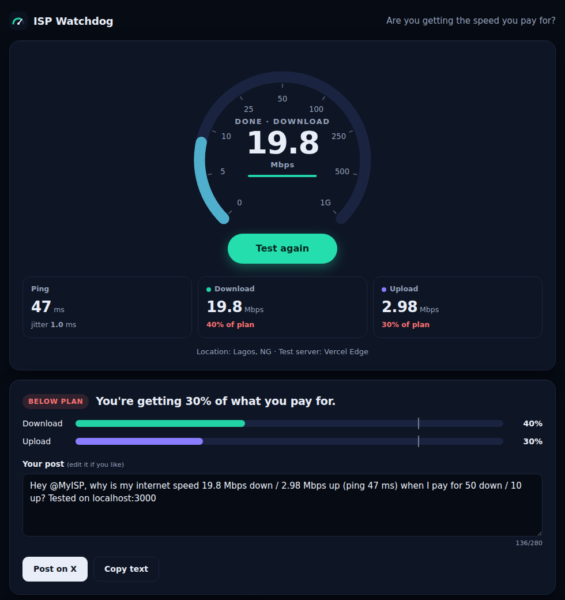

# ISP Watchdog

**Are you getting the internet speed you pay for?**

ISP Watchdog measures your real connection speed, compares it with the plan your provider promised, and drafts a post calling them out when they under-deliver. It comes in two forms:

| | Web app (`web/`) | Python bot (`main.py`) |
|---|---|---|
| Runs | In any browser, hosted on Vercel | On your computer, on demand or on a schedule |
| Measures with | Cloudflare's speed test network (fallback: own edge functions) | speedtest.net, driven by Selenium |
| Output | Live gauge, verdict vs. plan, one-click post on X, history chart, CSV export | Console report, `speed_history.csv`, X post via browser or API |

**Live demo:** https://isp-watchdog.vercel.app



## Web app

A dependency-free static site (HTML, CSS, vanilla JS) with three small Vercel Edge Functions.

- **Latency:** 20 sequential requests; reports median ping and jitter.
- **Download / upload:** 4 parallel streams for 8 s each. Request sizes adapt to your line speed, and the first 25 % of each phase is discarded to skip TCP ramp-up.
- **Verdict:** compares results against your plan with a configurable tolerance, then drafts an editable post for your provider.
- **History:** last 100 results stored in `localStorage`, with a trend chart and CSV export.

**Security and privacy**
- Strict Content-Security-Policy (no inline scripts, `connect-src` limited to self + Cloudflare), HSTS, `X-Frame-Options: DENY`, `nosniff`, Permissions-Policy and COOP headers (see `web/vercel.json`).
- No cookies, accounts, analytics or server-side storage. IP addresses are never returned or stored.
- Fallback endpoints cap payload sizes (25 MB down, 4 MB up) to limit abuse.

Run locally:

```bash
npm i -g vercel
cd web && vercel dev
```

## Python bot

```bash
python -m venv .venv
.venv\Scripts\activate          # Windows  (macOS/Linux: source .venv/bin/activate)
pip install -r requirements.txt
copy .env.example .env          # then edit your plan speeds and ISP handle
python main.py                  # run a test
python main.py --post browser   # open a pre-filled post on X if speed is below plan
python main.py --post api       # post directly with the X API (keys in .env, pip install tweepy)
python main.py --headless       # no visible Chrome window
```

What changed from the first version:
- Uses explicit waits instead of fixed `sleep()` calls, so it no longer breaks on slow or fast connections.
- Detects test completion from the result URL and reads numbers only once they're final.
- Settings and secrets live in `.env` (git-ignored) instead of the source code.
- The unfinished tweet step now works: it opens X's compose window (no password handling) or posts through the official API.
- Adds a history CSV, CLI flags, clean error messages and unit tests.

Schedule it with Windows Task Scheduler (e.g. every 6 hours) to build a record of your provider's performance.

## Tests

```bash
pip install pytest
python -m pytest
```

## Author

Built by Oladeji Victor Enoch.
